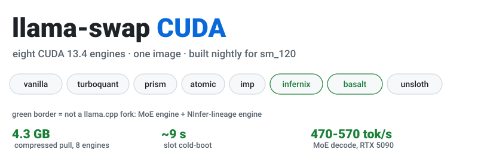
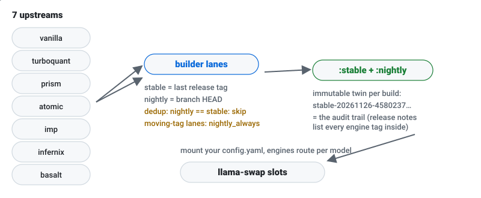

<picture>
  <source media="(prefers-color-scheme: dark)" srcset="assets/hero-dark.svg">
  
</picture>

[](https://github.com/tayuLuc/llama-swap-cuda-images/releases)
[](#how-it-is-built)
[](#how-it-is-built)
[](#quick-start)

Seven CUDA 13.4 inference engines for Blackwell (RTX 5090, sm_120), compiled by CI, packed into one image, republished on every upstream release **and** every upstream branch move. You `docker pull`, mount your models, and route any model to any engine from a YAML file.

```bash
docker run --gpus all -p 8080:8080 -v /path/to/models:/models \
  ghcr.io/tayuluc/llama-swap-cuda-images:stable
```

OpenAI-compatible endpoint on `:8080`. That's the whole installation.

**Live from a 32 GB RTX 5090, measured 26.11.2026:**

```text
$ curl :8080/v1/chat/completions -d '{"model":"Inkling-2-Mini-Unbound-Basalt", ...}'
prose 320 tok/s  ·  repetition 471 tok/s  ·  cold slot boot 8.5 s  ·  container healthy in 45 s
```

| | |
|---|---|
| [The seven](#the-seven-engines) | what ships, and which two are not llama.cpp at all |
| [Stable vs nightly](#stable-vs-nightly-the-honest-pipeline) | what each alias really contains |
| [Audit trail](#the-audit-trail) | which exact upstream commit is in the image you pulled |
| [Before → After](#before--after) | building this stack by hand |
| [Quick start](#quick-start) | copy-paste, 3 commands |
| [Gotchas](#gotchas-that-will-bite-you) | schema traps, drivers, venvs |

---

## The seven engines

<picture>
  <source media="(prefers-color-scheme: dark)" srcset="assets/pipeline-dark.svg">
  
</picture>

| Engine | What it is | Binary in image |
|--------|-----------|-----------------|
| **vanilla** | ggml-org/llama.cpp — the baseline | `/opt/llama/vanilla/llama-server` |
| **turboquant** | TheTom/llama-cpp-turboquant — quantized KV cache | `/opt/llama/turboquant/llama-server` |
| **prism** | PrismML-Eng/llama.cpp | `/opt/llama/prism/llama-server` |
| **atomic** | AtomicBot-ai fork with TurboQuant | `/opt/llama/atomic/llama-server` |
| **imp** | a separate engine: safetensors NVFP4/FP8 checkpoints, its own flags | `/opt/llama/imp/imp-server` |
| **infernix** | NInfer-lineage engine: reads NVIDIA Dense8 and `.ngram` volumes directly | `/opt/llama/infernix/infernix-serve` |
| **basalt** | a CUDA 13 MoE engine for Blackwell with speculative decoding — 470-570 tok/s measured on Inkling-2-Mini (26.11.2026) | `/opt/llama/basalt/bin/basalt` |

**Two of the seven are not llama.cpp forks** (green border in the hero): basalt is a MoE engine whose Python server needs a venv — the image builds one from a uv-managed CPython 3.13, no system apt python is installed anywhere in it. infernix speaks NVIDIA's own model formats. They launch as llama-swap slot commands, not as backend plugins.

Routing is one file. Every model declared in `llama-swap/config.yaml` maps to an engine, and `${models_dir}` resolves from the environment so the same image works against any host models directory:

```yaml
"inkling-2-mini-unbound":
  cmd: /opt/llama/basalt/bin/basalt serve --model ${models_dir}/Inkling.gguf --spec 8 --kv fp8
```

## Stable vs nightly: the honest pipeline

The aliases mean what they say, and each image carries its exact twin:

| Tag | Contains | Twin (audit) |
|-----|----------|--------------|
| `stable` | every engine at its **latest upstream release** | `stable-20261126-4580237…` |
| `nightly` | every engine at **branch HEAD** — commits upstream never released | `nightly-20261126-4583729…` |

Three pipeline details that make the aliases trustworthy:

1. **Nightly means "a commit upstream has not released yet."** When a branch HEAD equals the last release tag, the nightly build is deliberately skipped — two builds of one source is theater, not freshness. Lanes whose author retags a moving tag (like basalt, whose v-tag rides on master HEAD) opt into `nightly_always` so their nightly stays a real, separate build.
2. **No nightly artifact? The image still ships.** A lane without a nightly release ships empty with a note in the release body — one missing lane never blocks the image, and the notes always tell you which lane was empty.
3. **The fetch layer cannot be fooled by republished releases.** The build cache key includes each release asset's id, size and publish time, so an upstream that republishes the same tag with a different binary (it happens — an ffmpeg-8 asset once shipped through a green ABI gate via a stale cache) moves the key and forces a fresh fetch.

## The audit trail

Every image build cuts an immutable tag **and** a GitHub release listing the exact engine refs inside it. The real notes of `stable-20261126-45802377854`:

```text
vanilla: vanilla-2d5b3ddde360     turboquant: turboquant-f7c3638e83ff
prism: prism-f70247610e58         atomic: atomic-1937695dc64e
imp: imp-e1adccbea6fa             infernix: infernix-f768ca097771
basalt: v0.5.7
```

Rollback is a `docker pull` of any twin, not a rebuild.

## Before → After

| | building this by hand | this image |
|---|---|---|
| 7 CUDA 13.4 engines for sm_120 | 7 CUDA compiles, one Python venv, an ffmpeg build — days | one `docker pull` |
| upstream ships a fix | re-compile, re-test, repeat next week | `stable` moves on its own, cron 00:17Z |
| "what is in prod?" | "I think v0.5.7? built from master? on Thursday?" | the tag names its run id; the release lists all seven engines |
| bad build | bisect blind | pull yesterday's immutable twin |
| new Blackwell engine | start from its README and suffer | add a lane in the builder, everything downstream is automatic |

## Everything else you expect (yes, it's built in)

| | | | |
|---|---|---|---|
| ABI sanity gate: every binary must link `libcudart.so.13` | CUDA base pinned by digest, not by floating tag | alpine fetch stage — build deps never reach the runtime image | slots hot-reload: pass `--watch-config` in the container command, edit YAML live |
| basalt venv built by uv from `requirements.txt`, zero system python | healthcheck out of the box | `--watch-config` slot reload without container restart | release pruning so ghcr doesn't bloat |

## Reliability notes

- A lane build that produces a binary linked against the wrong CUDA major **fails the lane**, not silently ships.
- Nightly builds carry `pre=true` on their releases; stable never does.
- The container runs as the non-root `app` user.
- The builder dedups by commit ref, so a quiet upstream week costs zero GPU minutes.

## Quick start

```bash
docker run --gpus all -p 8080:8080 \
  -v /path/to/models:/models \
  -v $PWD/llama-swap/config.yaml:/etc/llama-swap/config.yaml:ro \
  ghcr.io/tayuluc/llama-swap-cuda-images:stable
```

Requirements: NVIDIA driver **≥ 580.13** (CUDA 13.4 floor; basalt needs R580+), `--gpus all` at runtime, linux/amd64.

<details>
<summary>Point it at your own models directory</summary>

The image reads `${MODELS_DIR}` (default `/models`) for the config macro, so the same image + config works against any host layout:

```bash
docker run --gpus all -p 8080:8080 \
  -v /mnt/bigdisk/LLMs:/app/models:ro \
  -e MODELS_DIR=/app/models \
  -v $PWD/config.yaml:/etc/llama-swap/config.yaml:ro \
  ghcr.io/tayuluc/llama-swap-cuda-images:stable
```

</details>

## Gotchas that will bite you

- **llama-swap v262 config schema**: `models` must be a **map keyed by model id**, the old list form (`- name: ".*"`) is rejected outright — and the image pins llama-swap via a moving tag, so read the schema after upgrades.
- **No regex catch-all**: `cmd` takes literal paths, so every model is declared. That's the point — one image, any host.
- **basalt is not a llama.cpp backend**: it is `basalt serve` exposing an OpenAI endpoint; slot commands launch it, `--lora`-style llama.cpp flags don't exist there.
- **Model name matching is strict** on basalt master (v0.5.7 accepted anything; master serves the declared name) — set the alias in the slot, not in the client.

## How it is built

The binaries are compiled in [`yet-another-llama.cpp-cuda-fork`](https://github.com/tayuLuc/yet-another-llama.cpp-cuda-fork) — one builder lane per engine (stable = latest release tag, nightly = branch HEAD, the dedup rules above). On each lane change it dispatches this repo's workflow with `mode=stable|nightly`; this repo fetches the seven artifacts of that mode and packs one image. Full pipeline:

<picture>
  <source media="(prefers-color-scheme: dark)" srcset="assets/pipeline-dark.svg">
  
</picture>

Repo layout: `Dockerfile` (multi-stage: fetch → venv → pack), `scripts/select-releases.sh` (which release goes into which mode), `scripts/fetch-binaries.sh` (per-lane download), `llama-swap/config.yaml` (reference config with every engine routed).

---

Built and measured on an RTX 5090 (32 GB) by people who run it 24/7. No license file yet — ask before you build a business on it.
